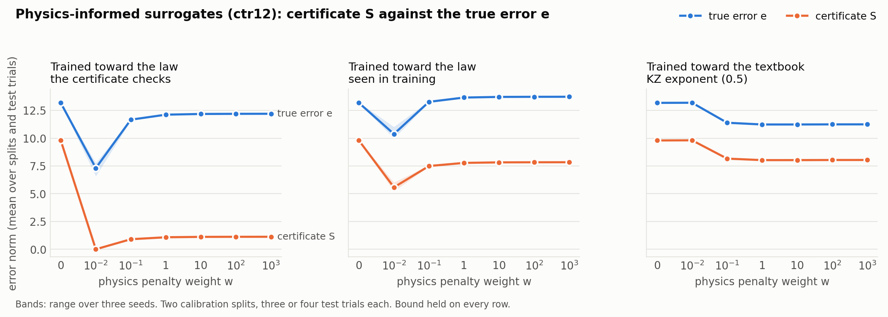

# Training a surrogate on the certificate's own law blinds the certificate

882 rows: 150 distinct physics-informed fits, three target laws, seven penalty
weights, three seeds, two representations, two calibration splits. Protocol
`PHYSICS_INFORMED_PROTOCOL.md`, fixed before the run. The surrogate is a two-layer
tanh network trained in numpy with the anchor-symmetry law as its physics term,
on unlabelled points beyond the training band (`pinn.py`; gradient verified to
1e-6 against finite differences in `test_pinn.py`).

## H1, the manipulation check: holds

The surrogate's own law residual falls monotonically with the penalty weight in
every arm and both representations (Spearman -1.000 in five of six, -0.995 in
the sixth). Everything below is interpretable.

## H2, the blind spot: supported, decisively

Plateau = mean over w >= 0.1.

| | e at w=0 | e plateau | S at w=0 | S plateau | median S/e | silent rate |
|---|---:|---:|---:|---:|---:|---:|
| ctr12, certificate law | 13.18 | **12.07** | 9.80 | **1.07** | 0.746 → **0.004** | 0% → **71%** |
| pist12, certificate law | 14.75 | **16.76** | 10.69 | **2.24** | 0.722 → **0.075** | 0% → **46%** |

Train the surrogate toward the law the certificate checks, and its true error
barely moves — on `pist12` it **gets worse** — while the certificate collapses
by a factor of 5 to 9 and falls silent on half to three quarters of cases. The
certificate reports the worse surrogate as the better one.

The bound held on all 882 rows. This is not a broken bound; it is a valid bound
that says almost nothing. It is the one-sided caveat of the paper — *a zero
certificate does not prove the surrogate is right* — measured instead of stated.

**Mechanism.** Once the surrogate follows the certificate's slope beyond its
training edge, its prediction differs from the certificate's centre only by a
constant: the level jump across the regime break at 55-105 mW, which the
surrogate never saw. The certificate sees that offset (mean defect 7.5) less its
growth radius, and nothing of the rest of the error (12.1).

**A disclosure about the verdict line.** `report.txt` prints "H2 NOT SUPPORTED"
from a rank-trend statistic (Spearman of S/e against log w) that was chosen
before the run. It was a poor choice: the response is a *step* at the smallest
weight followed by a plateau, and a monotone trend test cannot see a step
(rho -0.13 and -0.02). The protocol's own criterion was "falsified if S/e is flat
or rising"; S/e fell from 0.75 to under 0.01. Both are kept in the report, and
the protocol text is the governing criterion.

## H3, a wrong law hurts the surrogate: falsified

Trained toward the textbook KZ exponent of 0.5 — well below the measured slopes
of 1 to 7 — the surrogate's error *fell* (13.18 → 11.27 on ctr12, 14.75 → 12.67
on pist12) rather than rose. The unconstrained network extrapolates worse than a
mild fixed slope does. The certificate fell in proportion: median S/e stayed at
0.72 and 0.68, and it never went silent. Here the certificate behaved exactly as
intended — it tracked the error.

## The middle arm says the danger is wider than "the same law"

Trained toward the slope seen in the *training* band, a different law from the
one being checked:

* on `ctr12` the certificate still spoke (median S/e 0.66, silent 0%);
* on `pist12` it collapsed anyway (median S/e 0.039, silent 58%), while the error
  genuinely fell to 9.3.

On `pist12` the training-band slope happens to sit close to the certificate's, so
training toward it produced the same blindness. The risk is not confined to
reusing the identical law; a *similar* one is enough.

## A detail worth not over-reading

The weakest penalty, w = 0.01, produced the most accurate surrogates in both law
arms (error 7.31 on ctr12) — and the certificate was silent on **100%** of them.
It is a single weight, averaged over three seeds; it is noted, not interpreted.

## What this means for the method

**The certifying law must be independent of the training law.** The certificate
draws all of its information from the surrogate's departure from the law. A
physics-informed surrogate has removed that departure by construction, so
checking it with the law it was trained on certifies nothing — while still
returning a valid bound. A practitioner needs to know which physics the surrogate
was trained with before trusting a quiet certificate.

## Scope

Four distinct test trials on one apparatus; seeds and weights are not independent
replications. 24 of 252 fit-configurations hit the 20,000-iteration L-BFGS cap,
all at w = 1000, where the law residual is already below 0.002 and every table
entry matches w = 100 to two decimals; they are kept. The progress line in
`physics_informed_run.log` names only the last arm of each split — a cosmetic
print placement, left as is so the source hash in `results.json` still matches.

Reproduce with `python sases_eval/test_pinn.py`, then
`python sases_eval/physics_informed_audit.py`, `report_physics_informed.py` and
`plot_physics_informed.py`.
